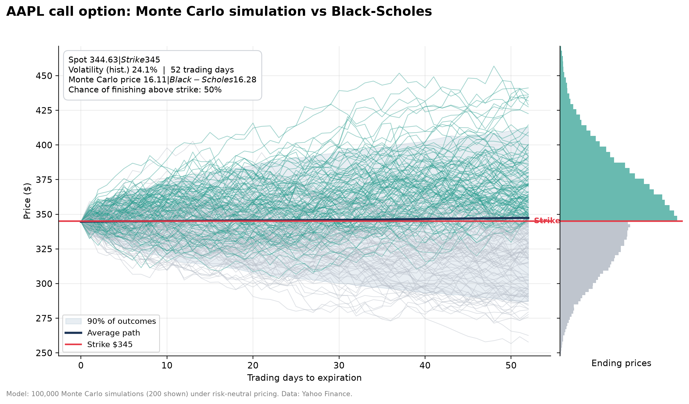
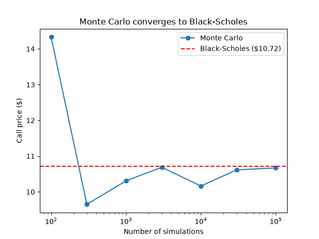
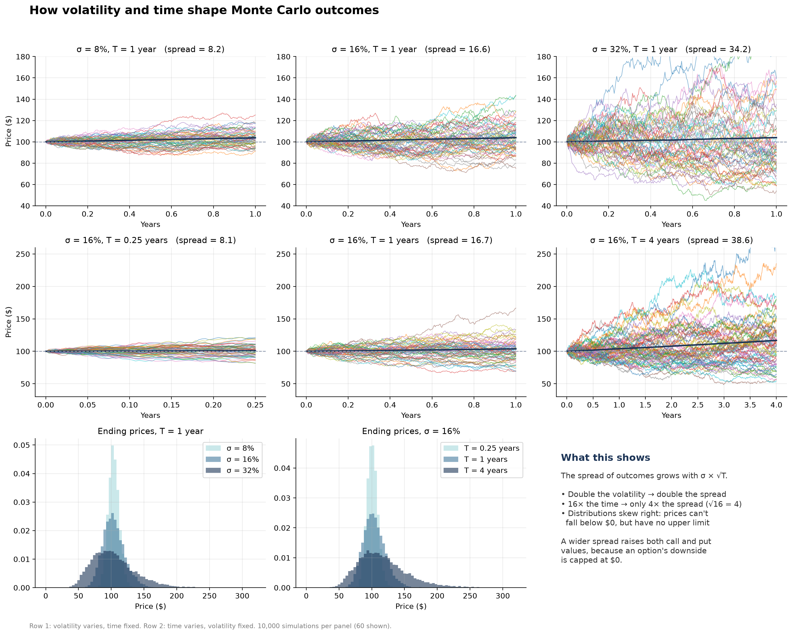
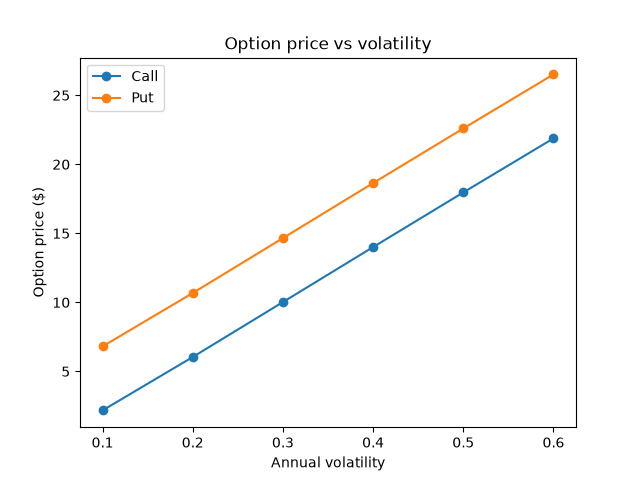
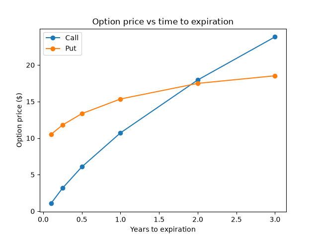

[README.md().md](https://github.com/user-attachments/files/34244826/README.md.md)
# Monte Carlo Option Pricing vs Black-Scholes

A Python project that prices European call and put options two independent ways, by **Monte Carlo simulation** and by the **Black-Scholes formula**, shows that the two converge, and then applies the model to a **real Apple (AAPL) option** to back out the market's implied volatility.



---

## Key results (AAPL call, strike $345, expiring 2027-01-15)

| | Value |
|---|---|
| Spot price | $344.63 |
| Historical volatility (1 year) | 24.1% |
| Risk-free rate (3-month Treasury) | 3.8% |
| Black-Scholes price | $16.28 |
| Monte Carlo price (100,000 simulations) | $16.29 |
| Market price (bid/ask midpoint) | $17.80 |
| **Implied volatility** | **26.6%** |

**Takeaway:** Monte Carlo and Black-Scholes agree to within a cent. The market prices the option higher than the model because it expects Apple to be about **2.5 percentage points more volatile** over the next few months than it was over the past year.

> Note: results depend on the date the data is downloaded and on the risk-free rate used.

---

## What the project does

1. **Simulates stock prices** with random daily returns drawn from a normal distribution
2. **Measures risk** from the simulated outcomes: chance of loss and Value at Risk (95% and 99%)
3. **Prices options with Monte Carlo** using risk-neutral pricing: simulate, average the payoffs, discount to today
4. **Prices options with Black-Scholes** and checks that both methods agree
5. **Shows convergence:** the Monte Carlo price approaches the Black-Scholes price as simulations increase
6. **Measures sensitivity** to volatility (vega) and time (theta)
7. **Applies the model to real data:** downloads AAPL prices, estimates volatility, prices a listed option, and solves for the implied volatility

---

## Charts

### Monte Carlo converges to Black-Scholes


With 100 simulations the price is far off. By 100,000 it matches Black-Scholes. The error shrinks with the square root of the number of simulations.

### How volatility and time shape outcomes


The spread of outcomes grows roughly with **σ × √T**: doubling volatility about doubles the spread, while 16 times the time only about quadruples it. Over long horizons the spread runs a bit higher than σ√T predicts, because compounding stretches the right tail. Distributions skew right because prices can't fall below $0 but have no upper limit.

### Option price vs volatility and time



Both calls and puts gain value as volatility rises, because an option's downside is capped at $0. Calls gain more from extra time than puts do, since a call's upside is unlimited and a put's strike is discounted more over long periods.

---

## Methods

**Monte Carlo (risk-neutral pricing)**
- Daily returns ~ Normal(r / 252, σ_daily), where the drift is the risk-free rate
- Call payoff = max(S_T − K, 0), put payoff = max(K − S_T, 0)
- Price = average payoff ÷ (1 + r)^T

**Black-Scholes**
- Call = S · N(d₁) − K · e^(−rT) · N(d₂)
- Put = K · e^(−rT) · N(−d₂) − S · N(−d₁)
- d₁ = [ln(S/K) + (r + σ²/2)T] / (σ√T), d₂ = d₁ − σ√T

**Implied volatility**
- Solved with `scipy.optimize.brentq`: find the σ at which the Black-Scholes price equals the market price

**Checks**
- Put-call parity: Call − Put = S − K · e^(−rT)
- Monte Carlo vs Black-Scholes convergence

---

## Files

| File | Purpose |
|---|---|
| `MC_convergence.py` | Monte Carlo pricing of calls and puts, convergence chart |
| `black_scholes.py` | Black-Scholes call and put prices |
| `MC_sensitivity.py` | Price vs volatility and time charts |
| `vol_time_grid.py` | σ√T grid of paths and distributions |
| `MC_realdata.py` | AAPL data, real option pricing, market comparison, implied volatility |
| `aapl_paths.py` | AAPL Monte Carlo chart |

## How to run

```
pip install numpy scipy matplotlib yfinance
python MC_realdata.py
```

---

## Limitations

- Assumes **constant volatility** and normally distributed daily returns; real markets have volatility that changes and fat tails
- Uses **historical volatility**, which may not reflect future volatility
- Prices **European** options only, with **no dividends**
- Uses simple daily returns and discrete discounting in the simulation, a close approximation to the continuous-time Black-Scholes model

---

## What I learned

I started this project without much of a math background. The first thing I simulated was a die: 10 rolls gave an average of 3.8, and 100,000 rolls gave 3.50. That was the moment Monte Carlo made sense to me. Each single outcome is random, but run enough of them and the average lands on the true value.

From there I simulated a stock. The way I think about it is a boat on a river: the drift is the current, a slow steady push in one direction, and volatility is the waves, big and random. Over a single day the waves dominate, but over years the current catches up, because the waves partly cancel out and only grow with the square root of time. That one idea ended up explaining most of the project, from why VaR grows with the time horizon to why the spread of outcomes grows with σ√T.

A few things surprised me:
- My simulated stock had a positive average return, yet about 40% of simulated years still ended in a loss. The average was pulled up by a small number of huge winners. That showed me why you look at the whole distribution, not just the average.
- Options get more valuable when volatility rises, both calls and puts. It clicked once I realized an option's downside is capped at zero, so bigger waves only add upside.
- I had to learn logs and e from scratch to work through Black-Scholes by hand. Calculating d₁ and d₂ myself and then seeing my Monte Carlo price converge to the same number was the most satisfying part of the project.

I also learned some practical lessons the hard way. I tried running 100 million simulations and crashed my laptop, which taught me about memory and about the square-root rule: 100 times more simulations only makes the answer about 10 times more precise. And when my model first came out at less than half the market price, the problem turned out to be that I was comparing it to an option with a different expiration date. Making sure the inputs actually describe the same contract mattered as much as the math.

The biggest takeaway for me was the implied volatility result. My model uses Apple's historical volatility, but the market is pricing in more volatility than Apple actually had over the past year. Seeing that gap is what turned this from a coding exercise into something that says something about the market.

## Next steps

- Calculate the full set of Greeks (delta, gamma, vega, theta, rho) in code
- Add dividends, since Apple pays one
- Price American options, which can be exercised early
- Compare implied volatility across different strikes and expirations to see the volatility smile
- Run the model on other stocks and compare how the market prices their volatility

---

*Volatility/maturity grid layout inspired by a similar chart I came across while learning. Built step by step as a learning project, with AI used as a tutor.*
